# Masroufi – Girl Maths edition 🎀
### CSEN 1114 – Lab 2 · Phase 1: Planning, data model & wireframes

Masroufi ("my expenses") helps the user track spending across days and months,
see trends and set goals. The twist: every purchase is logged with a
*girl-math justification* ("under 100 is basically free", "cost per wear"…).

---

## 1. Requirements

### 1.1 Functional requirements

| ID | Requirement | Phase | Where in the code |
|----|-------------|-------|-------------------|
| FR-01 | Add an expense (title, amount, category, date, optional note & photo) | 1–2 | `widgets/expense_form.dart` |
| FR-02 | Edit an expense | 2 | `expense_form.dart` (edit mode), `expense_detail_screen.dart` |
| FR-03 | Delete an expense (swipe or button) with **Undo** | 2 | `widgets/expense_tile.dart` |
| FR-04 | Choose a category from 8 girl-math justifications | 1 | `models/category.dart` |
| FR-05 | Validate input (title required, amount > 0) | 2 | `expense_form.dart` |
| FR-06 | View this month's total, today's total, count | 1 | `widgets/dashboard_cards.dart` |
| FR-07 | Browse expenses month by month, grouped by day | 3 | `screens/expenses_screen.dart` |
| FR-08 | Search expenses & filter by category | 3 | `expenses_screen.dart` |
| FR-09 | Expense details screen (named route, photo full-screen) | 3 | `screens/expense_detail_screen.dart` |
| FR-10 | Monthly summary: total, avg/day, forecast, purchases | 3 | `models/monthly_summary.dart`, `insights_screen.dart` |
| FR-11 | Graphs: category donut, daily bars, weekday bars, 6-month trend line | 3 | `widgets/charts.dart` |
| FR-12 | Discover trends: vs. last month, top category, busiest weekday, biggest purchase, month-end projection | 3 | `insights_screen.dart` |
| FR-13 | Set a monthly budget goal and see progress / daily allowance | 1–3 | `goals_screen.dart` |
| FR-14 | Wishlist savings goals with target, deadline, photo, "add money" | 3 | `goals_screen.dart`, `models/savings_goal.dart` |
| FR-15 | Settings persisted with SharedPreferences: theme (system/light/dark), language (EN/AR + RTL), currency, budget, "basically free" threshold, name & profile photo | 3 | `providers/settings_provider.dart`, `settings_screen.dart` |
| FR-16 | Images: asset illustrations + camera/gallery photos for receipts, goals and avatar | 3 | `services/image_storage.dart`, `assets/images/` |
| FR-17 | Navigation between 5 screens (bottom bar / rail) + named routes | 3 | `screens/main_navigation.dart`, `app.dart` |
| FR-18 | Cloud backup in Firebase Realtime Database | 4 | `services/firebase_service.dart` |
| FR-19 | Offline-first caching: show cache instantly, sync in background, queue offline changes | 4 | `services/sync_repository.dart` |
| FR-20 | Pull-to-refresh and "Sync now" | 4 | all list screens, settings |

### 1.2 Non-functional requirements

| ID | Requirement | How it is met |
|----|-------------|---------------|
| NFR-01 **Persistence** | Data survives app restarts and works without internet | SQLite cache + SharedPreferences; Firebase as backup |
| NFR-02 **Responsive UI** | Usable on small phones, rotated phones, tablets and desktop | Breakpoints (600 / 1024 px) with `LayoutBuilder` + `MediaQuery`; bottom bar ↔ `NavigationRail` ↔ extended rail; 1–3 column grids; two-column form & detail in landscape; master/detail on large screens |
| NFR-03 **State kept on rotation** | Rotating must not lose the open tab, month, search or filters | `IndexedStack` with a `GlobalKey`; UI state stored in `ExpenseProvider` |
| NFR-04 **Keyboard safe** | Form fields never hidden by the keyboard | `viewInsets` padding + `SingleChildScrollView` |
| NFR-05 **Performance** | Instant UI, no waiting for the network | Optimistic updates, cache-first loading, `const` widgets |
| NFR-06 **Usability / accessibility** | Clear feedback & large tap targets | Material 3, tooltips, snackbars with undo, empty states, loading indicators |
| NFR-07 **Localisation** | English & Arabic, RTL layout | `flutter_localizations`, `S` strings class |
| NFR-08 **Theming** | Light + "Midnight" dark theme | `core/app_theme.dart` |
| NFR-09 **Maintainability** | Layered architecture, testable logic | UI → Providers → Repository → (SQLite, Firebase); pure-Dart analytics |
| NFR-10 **Testability** | Automated tests | unit, repository (mock HTTP) & widget tests in `test/` |
| NFR-11 **Configuration** | No hard-coded backend URL | `.env` + `flutter_dotenv` |
| NFR-12 **Reliability** | No data loss offline | `is_synced` flag + `pending_deletes` queue, idempotent `PUT` with client ids |

---

## 2. Data model

### 2.1 Classes

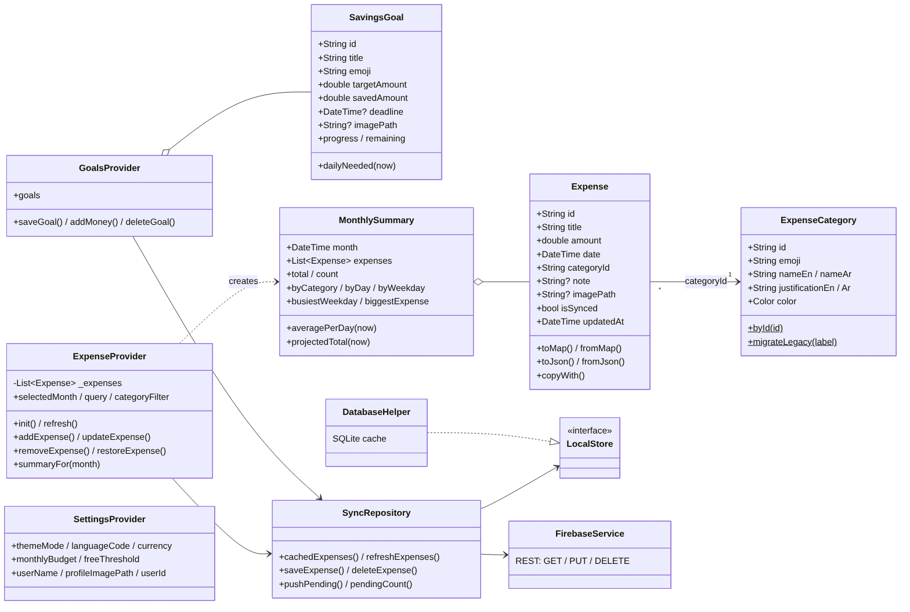

* **Expense** – one purchase. The id is generated on the device and reused
  as the Firebase key, so the same expense has the same id everywhere.
* **ExpenseCategory** – lookup data (emoji, EN/AR names, colour, justification).
* **SavingsGoal** – wishlist item with target, saved amount, optional deadline/photo.
* **MonthlySummary** – computed (not stored): totals and trends for one month.

### 2.2 Relational model (SQLite, schema v2)

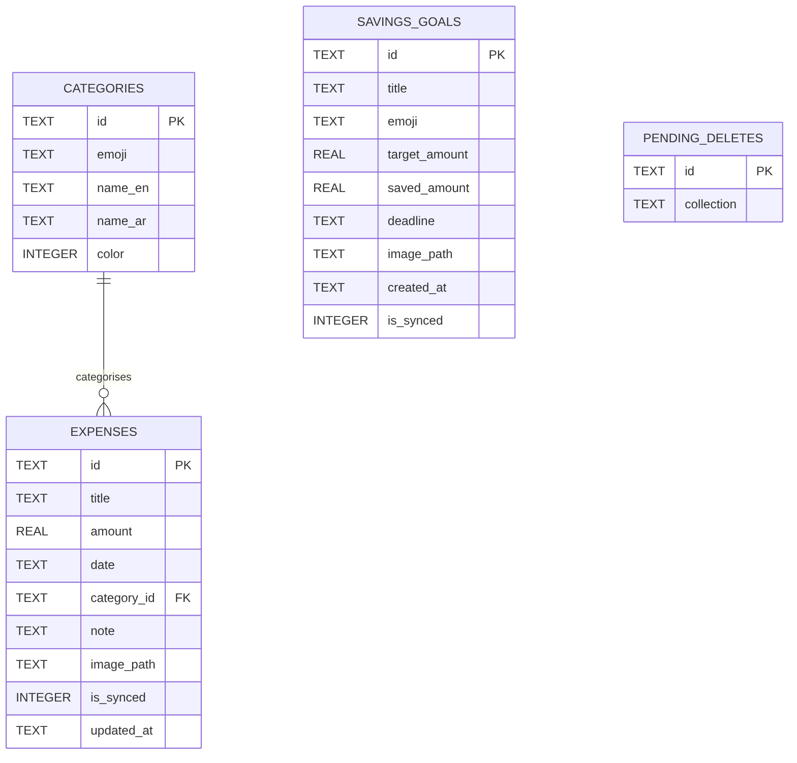

```
categories     (id PK, emoji, name_en, name_ar, color)
expenses       (id PK, title, amount, date, category_id FK→categories.id,
                note, image_path, is_synced, updated_at)
savings_goals  (id PK, title, emoji, target_amount, saved_amount, deadline,
                image_path, created_at, is_synced)
pending_deletes(id PK, collection)       -- offline delete queue
```

*Version 1 → 2 migration*: the old `expenses(id INTEGER, …, category TEXT)`
rows are copied into the new schema and the old category labels are mapped to
category ids, so nothing is lost when upgrading.

### 2.3 Firebase Realtime Database (JSON tree)

```json
{
  "users": {
    "<anonymous-install-id>": {
      "expenses": { "e1730...": { "title": "Iced latte", "amount": 85,
                                  "date": "2026-11-03T09:00:00.000",
                                  "categoryId": "coffee", "note": null,
                                  "updatedAt": "..." } },
      "goals":    { "g1730...": { "title": "That bag", "emoji": "👜",
                                  "targetAmount": 3000, "savedAmount": 1200,
                                  "deadline": "...", "createdAt": "..." } }
    }
  }
}
```

Photos stay on the device (only their local path is kept in SQLite).

### 2.4 Architecture

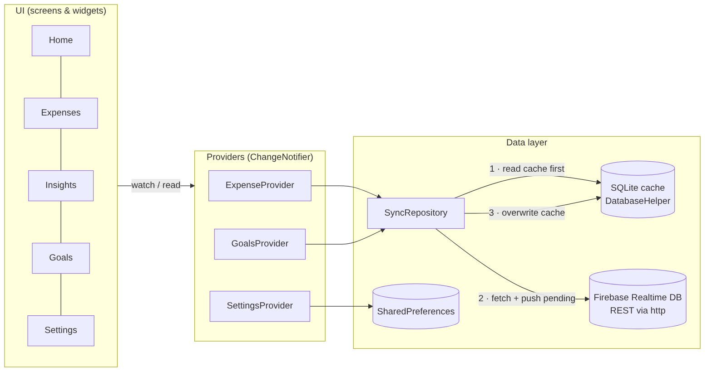

Caching flow (Lecture 6): **startup → load from cache → show immediately →
fetch from Firebase (after pushing pending changes) → update provider → save to cache.**

---

## 3. Wireframes

| | | |
|---|---|---|
| 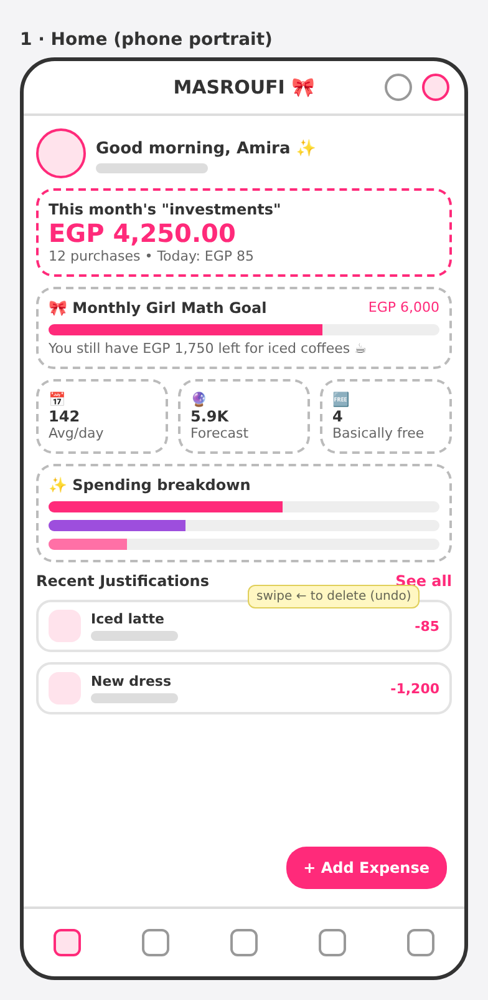 | 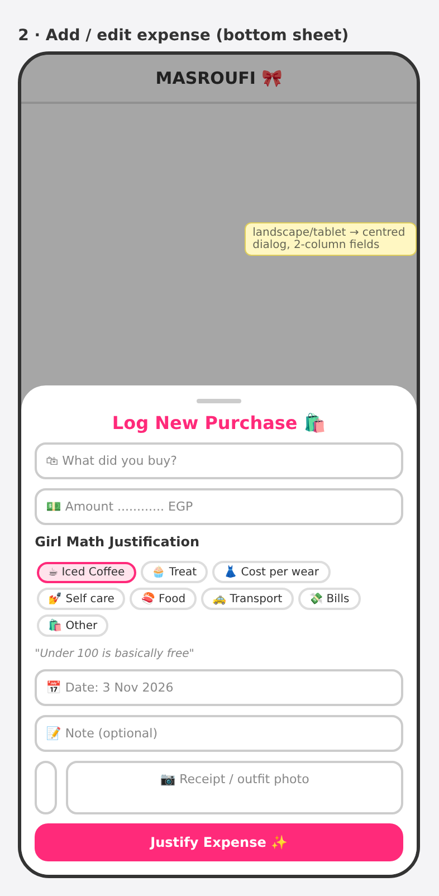 | 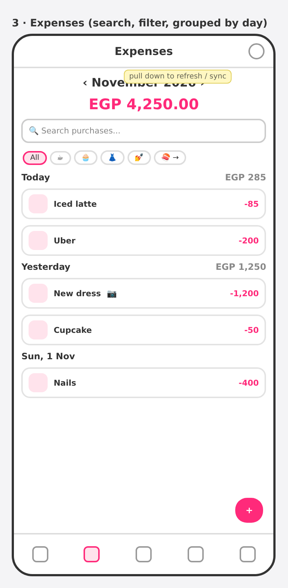 |
| 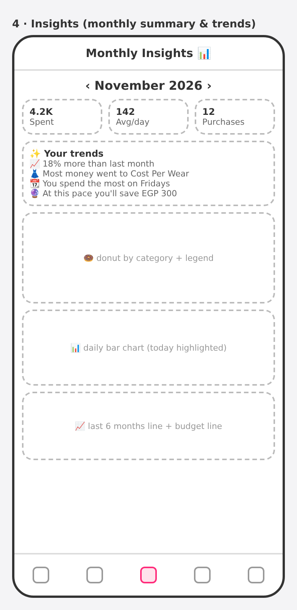 | 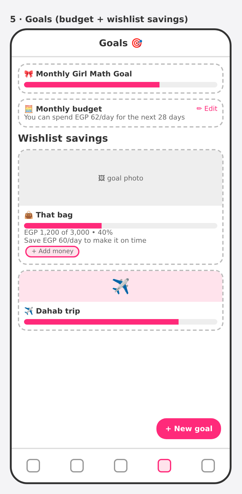 | 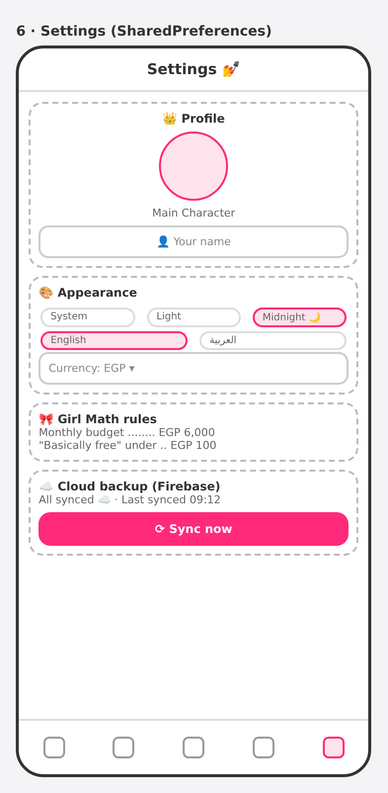 |

**Responsive layouts**

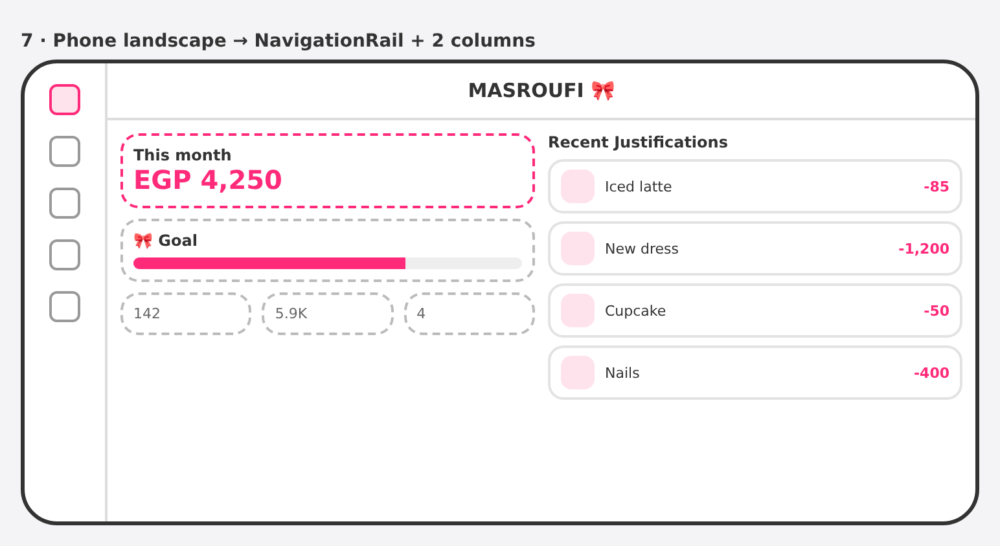

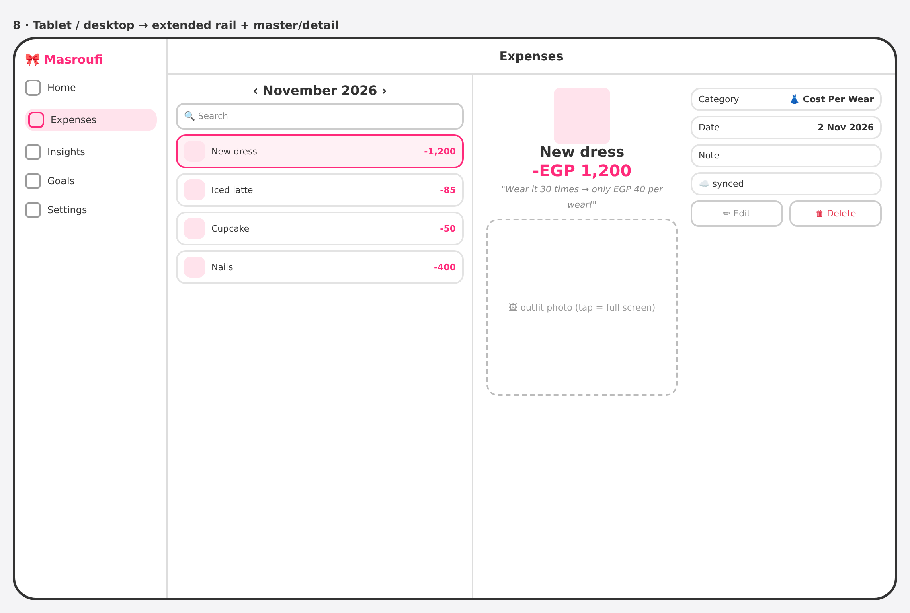

| Window | Navigation | Layout |
|--------|-----------|--------|
| < 600 px, portrait | bottom `NavigationBar` | single column, form as bottom sheet |
| phone landscape / 600–1023 px | `NavigationRail` (labels on selected item when short) | dashboard + list side by side, 2-column grids, form as dialog |
| ≥ 1024 px | extended `NavigationRail` with logo | up to 3 columns, master/detail expenses |

---

## 4. Phase 2 – test plan

| Test file | What it checks |
|-----------|----------------|
| `test/models_test.dart` | map/JSON round-trips, legacy v1 rows, id format, goal maths |
| `test/analytics_test.dart` | monthly totals, category order, per-day/weekday buckets, projection, year boundary |
| `test/repository_test.dart` | online save, offline queue + replay, offline delete, multi-device merge, no-backend mode (mock HTTP server) |
| `test/widget_test.dart` | dashboard, bottom bar vs rail, tab kept on rotation, extended rail on tablets, add-expense form + validation, Arabic RTL |

Run with `flutter test`.
